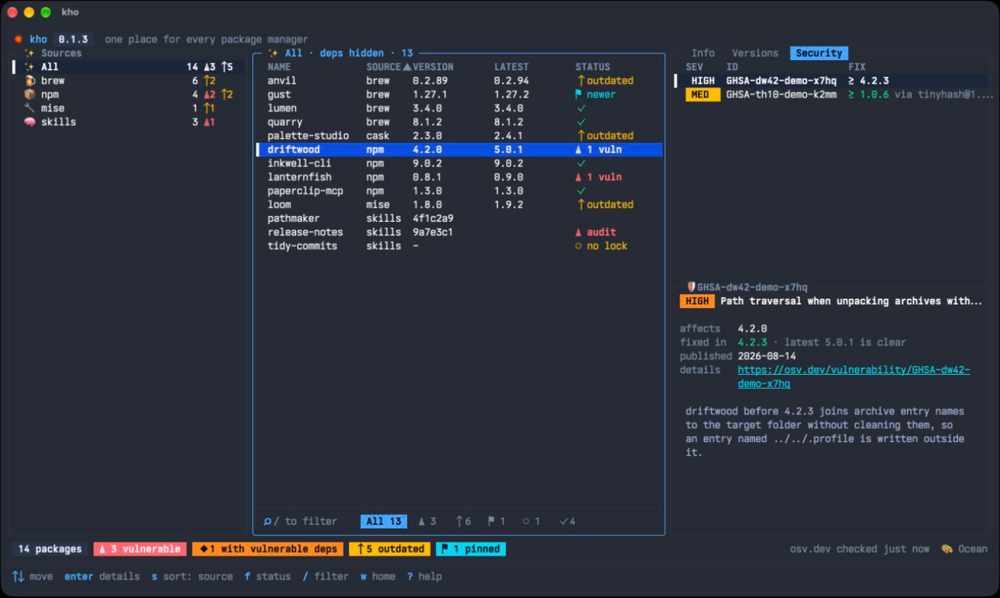

# 🏮 kho

[](https://github.com/vuon9/kho/actions/workflows/ci.yml)
[](https://github.com/vuon9/kho/releases)

**One place for every package manager on your machine, with security checks.**



*Kho* is Vietnamese for storehouse. It lists what Homebrew, npm, pipx, uv, `go install`, mise and the skills CLI have put on your machine, tells you which of those packages have known vulnerabilities, and upgrades them only when you say so. It runs as a terminal app for you and as a JSON CLI for your agents.

<details>
<summary>See it run</summary>

https://github.com/user-attachments/assets/43589fd4-a4dc-4db9-9995-a347629e7f47

</details>

## What it does

- **Everything in one list.** Packages from every manager in one table, with installed and latest versions. Sort by any column, filter by name or status, and each source keeps its own filters.
- **Knows what's unsafe.** Checks packages against [OSV](https://osv.dev) and agent skills against [skills.sh](https://skills.sh) audits. Each version in a package's history is marked as affected or safe, so you can see which upgrade actually fixes things.
- **Reads before you change.** Versions with their release notes, dependencies (flagged when they're vulnerable), and for skills: SKILL.md, the README, and which agents can see the skill.
- **Changes only on your say-so.** Pick a version to upgrade or downgrade, read the exact command, confirm, and watch it run in a popup without leaving kho. Link or unlink a skill for any agent the skills CLI supports. Every command kho runs is kept in a history you can browse.
- **Works for agents too.** `kho check --json` answers "am I safe?" and the `use-kho` skill teaches an agent to report risks and fix them with your approval.
- **Pleasant to live in.** Mouse and keyboard, resizable panels, selectable text, five themes, a `?` key that lists every shortcut.

## Supported sources

| Source | What kho reads | Latest version from | Security |
|---|---|---|---|
| Homebrew formulae and casks | `brew info --json=v2 --installed` | Homebrew | not covered by OSV yet |
| npm globals | `npm ls -g`, `npm outdated -g` | npm registry | OSV, plus direct dependencies |
| pipx | `pipx list --json` | PyPI | OSV |
| uv tools | `uv tool list` | PyPI | OSV |
| `go install` binaries | build info inside each binary | Go module proxy | OSV, plus every module built in |
| mise | `mise ls --json`, `mise outdated` | mise | not covered by OSV yet |
| Agent skills | the skills CLI's lock file and agent folders | the source repo on GitHub | skills.sh audits (Gen, Socket, Snyk) |

## Install

```bash
brew trust vuon9/tap          # Homebrew 7 loads no cask from an untrusted tap
brew install --cask vuon9/tap/kho
```

or, with Go:

```bash
go install github.com/vuon9/kho@latest
```

To check that an archive from the [Releases page](https://github.com/vuon9/kho/releases) was built by this repo's release workflow, verify its signed build provenance with the GitHub CLI (2.49 or later, signed in):

```bash
VERSION=0.1.5   # the release you downloaded
gh attestation verify "kho_${VERSION}_darwin_arm64.tar.gz" --repo vuon9/kho \
  --signer-workflow vuon9/kho/.github/workflows/release.yml
```

## Use it

Run `kho`. Press `?` at any time for every key.

| Key | Does |
|---|---|
| `tab` `h` `l` | move between Sources, Packages and the sidebar |
| `↑` `↓` `enter` | pick, then open in the next panel |
| `/` `f` | filter by name, step through status filters |
| `s` `S` | sort by the next column, reverse it |
| `i` `v` `a` | sidebar tabs: Info, Versions, Security |
| `enter` on a version | upgrade or downgrade to it, after a confirmation |
| `H` | history of every command kho ran |
| `<` `>` `{` `}` | resize panels and the sidebar's halves |
| `t` | next theme |
| `w` `c` | open the homepage, copy the text you're reading |

## For agents

Give your agents the `use-kho` skill. `-g` installs it for your user, so it works in every project:

```bash
npx skills add vuon9/kho --skill use-kho -g
```

Then ask it "/use-kho am I safe?" or "/use-kho fix what's vulnerable". The skill runs kho's JSON commands, reports each risk with the version that fixes it, and upgrades a package only after you say yes to that package.

For a daily security report, paste a prompt like this into Claude Code, Hermes Agent, or any agent that can schedule tasks:

```text
With the use-kho skill, set up a task that runs on this machine every
morning at 9. It must run here, not in the cloud, because kho reads the
packages installed on this machine.

Each run, check the machine with kho and send me the report the skill
describes: the verdict, each vulnerable package and the version that
fixes it, skills that failed an audit, and what wasn't checked. List
each fix as a dry run. Never install or change anything from the
scheduled task. I'll approve updates in a conversation.

Run it once now so I can see a report, and tell me how to pause it.
```

Scripts can call the same commands: `kho check --json` exits 0 when safe, 3 when at risk, and 4 when the scan was not complete and a gate was asked for. `--require uv,npm` fails only when one of the named managers could not be read, which is what a scheduled check wants; `--require-complete` fails whenever anything was skipped or failed, an OSV or skills.sh lookup included. `kho help` lists the rest.

## What leaves your machine

kho changes nothing until you confirm. To check versions and security it asks the services below about the packages you have, so each one learns those package names and sees your IP address, as it would when your package managers check for updates. Nothing else is sent: no analytics, no paths, no file contents.

| Where | What it learns | Asked by |
|---|---|---|
| OSV (`api.osv.dev`) | names and versions of npm, PyPI and Go packages, and of their dependencies | kho |
| PyPI (`pypi.org`) | names of pipx and uv packages | kho |
| Go module proxy (`proxy.golang.org`) | module paths of `go install` binaries | kho |
| GitHub API (`api.github.com`) | repositories of skills, and of packages that link one, for commits and release notes | kho |
| skills.sh | skill names and their repositories | kho |
| npm registry | names of global npm packages | `npm outdated`, `npm view` |
| mise's sources | names of mise tools | `mise outdated`, `mise ls-remote` |

Homebrew answers from its local copy of its package list. When you confirm an install, the package manager downloads it as it always does.

kho uses your GitHub token (`GITHUB_TOKEN`, `GH_TOKEN` or `gh auth token`) only for GitHub's API, which allows 60 requests an hour without one. It keeps the token in memory and never stores or prints it.

On disk, kho keeps:

- a security cache, reused for 12 hours: `kho/security.json` in your user cache folder (`~/Library/Caches` on macOS)
- the last 500 commands it ran: `~/.local/state/kho/history.jsonl`
- your theme: `theme`, next to the history

## Contributing

Read [AGENTS.md](AGENTS.md) first: it has the layout, the rules and the checks. In short:

```bash
go vet ./... && go test -race ./...
```

Commits follow [Conventional Commits](https://www.conventionalcommits.org), which is how releases get their version and changelog.

## License

[MIT](LICENSE)
